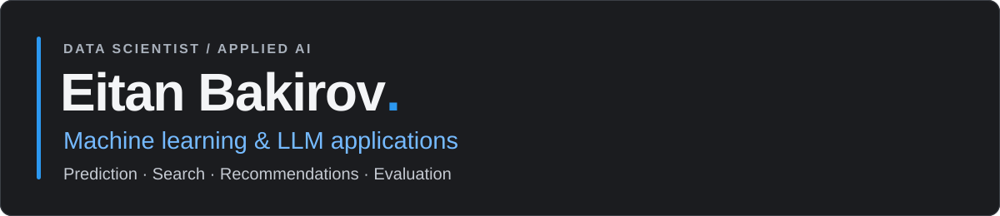

  

  
  
  

## Hi, I'm Eitan

I'm a data scientist working across **ML models, recommendations, search, and LLM applications**, from embeddings and evaluation to integration into production systems.

- **Data Scientist at Argmax · July 2025–present** — advertising prediction models, probability calibration, hybrid search, and personalized recommendations.
- **Previously, AI Engineer Intern at Checkmarx · 2024** — LLM-based code similarity, synthetic benchmark datasets, model evaluation, and application development.
- **Earlier, SAP System Analyst & Instructor in the IDF · 2018–2021** — system analysis, implementation, and technical instruction.

## Technical toolkit

| Area | Methods and tools |
| --- | --- |
| **Prediction & evaluation** | Classification, regression, probability calibration, benchmarking · scikit-learn, XGBoost, MLflow |
| **Search & recommendations** | Text/image embeddings, hybrid retrieval, personalized recommendations · OpenSearch, Qdrant |
| **LLM applications** | Code similarity, RAG, model evaluation · OpenAI API, Azure OpenAI, Hugging Face |
| **Data & application engineering** | Python, SQL, PySpark, Databricks, FastAPI, Vue.js, Streamlit, Docker, Git |

## Selected projects

<table>
  <tr>
    <td colspan="2" valign="top">
      
      <h3><a href="https://github.com/codematch-llm/system">CodeMatch</a></h3>
      
<strong>Checkmarx internship · LLM embeddings and evaluation</strong>

      
Developed code-similarity tools with LLM embeddings and Qdrant, synthetic-data benchmarks for pairwise comparison and retrieval evaluation, and FastAPI/Vue.js application components.

      
<code>LLMs</code> <code>Embeddings</code> <code>Qdrant</code> <code>Benchmarking</code> <code>FastAPI</code>

      
<a href="https://github.com/codematch-llm/system">Application</a> · <a href="https://github.com/codematch-llm/benchmark">Benchmark framework</a>

    </td>
  </tr>
  <tr>
    <td width="50%" valign="top">
      <h3><a href="https://github.com/EitanBakirov/nyc-uber-demand-prediction">NYC Uber Demand Prediction</a></h3>
      
<strong>Academic team project</strong>

      
Predicted 15-minute Uber pickup demand near the Empire State Building using historical pickups, weather, events, and taxi activity. Compared linear regression and tree ensembles, training on April–August and evaluating on September 2014.

      
<code>Demand prediction</code> <code>Feature engineering</code> <code>CatBoost</code> <code>Temporal evaluation</code>

    </td>
    <td width="50%" valign="top">
      <h3><a href="https://github.com/EitanBakirov/music-recommendation-system">Music Recommendation System</a></h3>
      
<strong>Academic team project</strong>

      
Compared collaborative filtering and matrix-factorization models on the Million Song Dataset, evaluating recommendations with precision/recall at 10, MAE, and RMSE.

      
<code>Recommenders</code> <code>Matrix factorization</code> <code>Evaluation</code>

    </td>
  </tr>
  <tr>
    <td width="50%" valign="top">
      <h3><a href="https://github.com/EitanBakirov/hmo-chatbot">HMO Service Chatbot</a></h3>
      
<strong>Applied AI prototype</strong>

      
A Hebrew/English service-information chatbot using document retrieval and Azure OpenAI, with FastAPI endpoints, a Streamlit interface, and logging for latency and token usage.

      
<code>RAG</code> <code>Azure OpenAI</code> <code>FastAPI</code> <code>Streamlit</code>

    </td>
    <td width="50%" valign="top">
      <h3><a href="https://github.com/EitanBakirov/malicious-file-classification-app">Malicious File Classification</a></h3>
      
<strong>Academic team project + application</strong>

      
A static-feature classification workflow covering preprocessing, model comparison, and cross-validation, paired with a Streamlit interface for exploring predictions and detection thresholds.

      
<code>Classification</code> <code>Random Forest</code> <code>Streamlit</code>

    </td>
  </tr>
</table>

**[More projects and work experience on my portfolio →](https://eitanbakirov.github.io/)**

  
<strong>More project work</strong>

- [TV Dialogue Classification](https://github.com/EitanBakirov/tv-show-dialogue-classification) — NLP and deep learning for classifying dialogue from Friends and Seinfeld.
- [Bicycle Rental Demand Prediction](https://github.com/EitanBakirov/bicycle-rental-demand-prediction) — regression modeling for rental demand.
- [Boston Airbnb Analysis](https://github.com/EitanBakirov/boston-airbnb-analysis) — exploratory analysis and visualization in R.
- [Slug Wars](https://github.com/EitanBakirov/slug-wars) — a C#/MonoGame turn-based artillery game with destructible terrain, built as my software-engineering final project.

## Education

**B.Sc. in Digital Sciences for High-Tech and Economics · Tel Aviv University, 2021–2024**  
Coursework included machine learning, deep learning, statistics, databases, algorithms, and data analysis.

**Software Engineering Technician Certification · Hakfar Hayarok College, 2017–2018**

---

[Email](mailto:eitanbakirov@gmail.com) · [LinkedIn](https://www.linkedin.com/in/eitan-bakirov/) · [Portfolio](https://eitanbakirov.github.io/)
